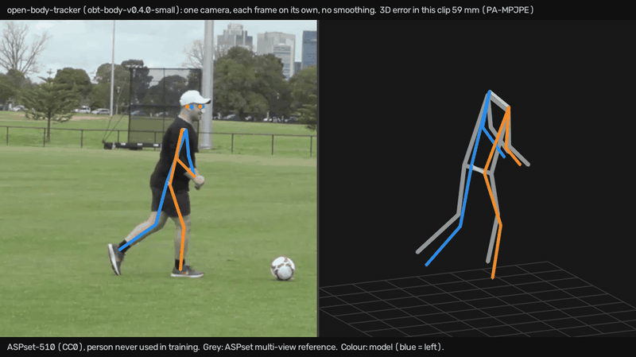
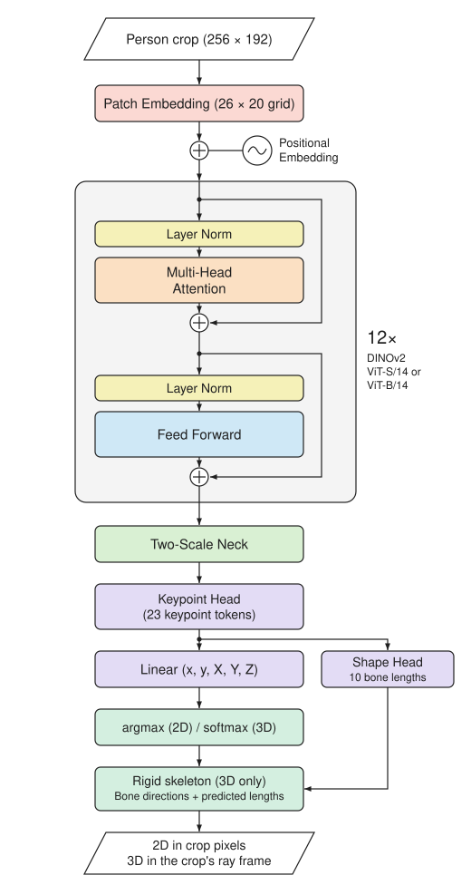

<p align="right"><a href="README.md">English</a> · <b>日本語</b></p>

<h1 align="center">open-body-tracker</h1>

<p align="center">
  RGBカメラ1台で全身の3D姿勢を推定。23点を画像上の2Dとメートル単位の3Dで、リアルタイムに。<br>
  v0.5.0から手にも対応（片手21点、ベータ版）。<br>
  <a href="https://yuru-lab.github.io/open-body-tracker/"><b>ブラウザデモ（v0.4.0-small）</b></a> ·
  <a href="https://huggingface.co/Yurup/open-body-tracker">モデル（Hugging Face）</a> ·
  <a href="docs/MODELS.md">評価</a>
</p>

<p align="center"></p>

<p align="center"><sub>学習に一度も使っていない人の映像（<a href="https://github.com/anibali/aspset-510">ASPset-510</a>、CC0）。
グレーが正解の3D、色がobt-body-v0.4.0-small（カメラ1台、ASPsetの人物枠を使用、平滑化なし）。<br>3D誤差（PA-MPJPE）はこのクリップで59 mm、ASPsetの評価用クリップ全体で平均50.3 mmです。</sub></p>

## モデル

| | **obt-body-v0.5.0-small**（標準） | **obt-body-v0.4.0** | obt-body-v0.4.0-small |
|---|---:|---:|---:|
| 手 | 片手21点（ベータ版） | — | — |
| 3D誤差・Harmony4D 06/16（PA-MPJPE）¹ | 48.8 mm | **45.2 mm** | 49.4 mm |
| 3D誤差・Harmony4D 01/05/15（PA-MPJPE） | 52.1 mm | **48.9 mm** | 52.8 mm |
| 3D誤差・ASPset（学習に使っていない3人、PA-MPJPE） | 50.1 mm | **48.1 mm** | 50.3 mm |
| 2D精度（COCO val2017 clean AP） | 69.1 | **72.8** | 69.9 |
| 速度（1人）：GPU fp16 · CPU int8 | 5 ms · 52 ms（＋手 3 ms · 17 ms） | 6 ms · 120 ms | 5 ms · 48 ms |

¹ v0.4.0を確定するまで開けずにおき、確定後はリリースごとに一度だけ採点しているHarmony4Dの2系列。速度はRTX 5080
（PyTorch）とCore i5-12600（ONNX Runtime、4スレッド）。標準のv0.5.0-smallは、v0.4.0-smallを新しい手のモデルと
一緒にさらに学習したもので、3Dは少し正確になり、COCO APは0.8下がりました。体がいちばん正確なのはv0.4.0です（手は
ありません）。いずれにもCPU向けのINT8版があります。手の精度はまだ数値を公開していません
（[理由](docs/MODELS.md#hands-beta)、英語）。版の一覧やほかの評価、測り方は[docs/MODELS.md](docs/MODELS.md)（英語）に
あります。

ほかのモデルとの比較（同じフレーム・同じ採点、[詳細](docs/MODELS.md#other-models-on-the-same-benchmarks)）：

| | 3D誤差・Harmony4D 06/16 | 3D誤差・Harmony4D 01/05/15 | COCO val2017 clean AP | 速度（1人） |
|---|---:|---:|---:|---:|
| **obt-body-v0.4.0** | **45.2 mm** | 48.9 mm | 72.8 | GPU 6 ms · CPU 120 ms（int8） |
| **obt-body-v0.5.0-small** | 48.8 mm | 52.1 mm | 69.1 | GPU 5 ms · CPU 52 ms（int8） |
| **obt-body-v0.4.0-small** | 49.4 mm | 52.8 mm | 69.9 | GPU 5 ms · CPU 48 ms（int8） |
| InstantHMR medium-commercial | 47.1 mm | 40.6 mm ² | — | GPU 約1 ms（公表値、TensorRT） |
| MediaPipe Pose Full / Heavy | — | 103.3 / 105.8 mm | — | CPU 25 / 52 ms |
| RTMW-m（2Dのみ） | — | — | 74.1 | GPU 9 ms |
| SAM 3D Body（学習ラベルの元、ずっと大きいモデル） | — | 34.6 mm | — | GPU 115 ms |

² InstantHMRはHarmony4D 01/05/15と同じセッションの別の録画（同じ人・同じ会場）で学習しています。
Harmony4D 06/16はobt-bodyの各モデルとInstantHMRのいずれも学習に使用していません。

## しくみ

YOLOXで人を検出し、約1秒ごと、または追跡が途切れたときに再検出します。検出の間は、直前に推定した姿勢から次のフレームの人物枠を作ります。
256 × 192に切り抜いて姿勢モデルに入力し、One Euroフィルターで揺れを抑えます。
手を有効にすると、姿勢モデルが手のおおよその位置も出します。それぞれの手を140 × 140に切り抜き、手のモデル
（同じバックボーンに専用のヘッド）が21点を求めます。

<p align="center"></p>

## はじめかた

```sh
git clone https://github.com/yuru-lab/open-body-tracker && cd open-body-tracker
mise install && mise run setup   # または Python 3.12 + uv で `uv sync`
mise run demo                    # Webカメラ。初回にモデルをダウンロード
```

```sh
uv run obt-demo --image photo.jpg               # photo.pose.jpg を書き出す
uv run obt-demo --hands                         # 手も（ベータ版）
uv run obt-demo --model-version v0.4.0-small-int8   # CPUで速い
uv run obt-demo --model-version v0.4.0          # 大きく、より正確なモデル
uv sync --extra gpu && uv run obt-demo --gpu    # CUDA
```

ブラウザデモを手元で動かす：`mise run web` を実行して http://localhost:8000 を開きます。

## コードから使う

```python
import cv2
from open_body_tracker.detector import PersonDetector
from open_body_tracker.hub import fetch, model_file
from open_body_tracker.pipeline import PosePipeline

pipeline = PosePipeline(fetch(model_file()), PersonDetector(fetch("yolox_nano.onnx")))
pose = pipeline(cv2.imread("photo.jpg")[:, :, ::-1].copy())  # RGB
pose["xy"]     # (23, 2) 画像のピクセル座標
pose["score"]  # (23,)   自信度
pose["xyz"]    # (23, 3) メートル、腰の中心が原点、カメラの軸（x右・y下・z奥）
```

手（v0.5.0、ベータ版）：手のモデルを渡すと、`pose["hands"]` に `"right"` と `"left"` が入ります。それぞれ `None`
（手首が写っていない）か、`xy` (21, 2) 画像のピクセル座標・`score` (21,)・`xyz` (21, 3) メートルの辞書です。
`xyz` は `pose["xyz"]` と同じ座標系で、体の手首の位置に置かれます（[hands.py](src/open_body_tracker/hands.py)）。

```python
from open_body_tracker.hub import hand_model_file
pipeline = PosePipeline(fetch(model_file()), PersonDetector(fetch("yolox_nano.onnx")), hand_model=fetch(hand_model_file()))
```

v0.4.0以降のモデルは、切り抜きの中心をまっすぐ見た向きで3Dを出し、カメラの焦点距離を使ってカメラの軸に直します。
焦点距離がわかるときは `PosePipeline(..., focal=焦点距離px)`（`obt-demo --focal`）で渡してください。
渡さないときは水平画角65°のカメラとみなします（[geometry.py](src/open_body_tracker/geometry.py)）。

点はCOCOの17点＋左右の足の親指・小指・かかとです（[keypoints.py](src/open_body_tracker/keypoints.py)）。
手は指ごとに4点と手首です（[hands.py](src/open_body_tracker/hands.py)）。

モデルは腰が写っていないとき（肩までの構図、机の向こうなど）も腰を推定するので、その推定の揺れで3D全体が揺れます。
`PosePipeline(..., anchor=True)`（`obt-demo --anchor`）にすると、腰が見えなくなれば肩、肩も見えなくなれば顔へと、
3Dの原点を飛ばずに滑らかに移します。いまの割合は `pose["origin"]` に入ります（[anchor.py](src/open_body_tracker/anchor.py)）。

## もっと知る

- [モデルの版と評価](docs/MODELS.md) · [モデルカード](MODEL_CARD.md) · [学習データ](DATA.md)（英語）
- [学習の再現](docs/REPRODUCE.md)：コードは [`training/`](training/)（v0.1.0〜v0.3.0）

## ライセンス

コードとモデルの重み：[Apache-2.0](LICENSE)。学習ラベルの一部にMetaの[SAM 3D Body](https://github.com/facebookresearch/sam-3d-body)の推定結果を使いました。感謝します。詳細と第三者の表示：[docs/LICENSING.md](docs/LICENSING.md)（英語）· [NOTICE](NOTICE)

研究用のソフトウェアです。医療機器や計測機器ではありません。
