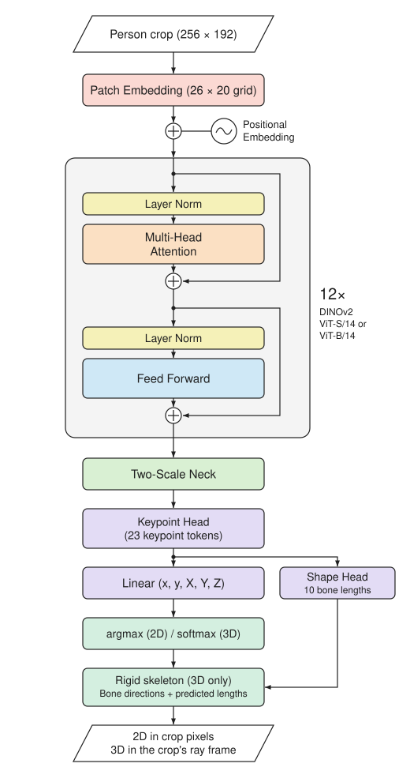

<p align="right"><b>English</b> · <a href="README.ja.md">日本語</a></p>

<h1 align="center">open-body-tracker</h1>

<p align="center">
  Full-body 3D pose from one RGB camera: 23 keypoints in 2D and in metres, in real time.<br>
  <a href="https://yuru-lab.github.io/open-body-tracker/"><b>Browser demo</b></a> ·
  <a href="https://huggingface.co/Yurup/open-body-tracker">Models (Hugging Face)</a> ·
  <a href="docs/MODELS.md">Benchmarks</a>
</p>

<p align="center"></p>

<p align="center"><sub>A person never used in training (<a href="https://github.com/anibali/aspset-510">ASPset-510</a>, CC0).
Grey: reference 3D. Colour: obt-body-v0.3.0, one camera, no smoothing.<br>3D error in this clip 56 mm; 53.7 mm on average.</sub></p>

## Models

| | **obt-body-v0.4.0-small** (default) | **obt-body-v0.4.0** | obt-body-v0.3.0 |
|---|---:|---:|---:|
| 3D error, Harmony4D 06/16 (PA-MPJPE) ¹ | 49.4 mm | **45.2 mm** | — |
| 3D error, Harmony4D 01/05/15 (PA-MPJPE) | 52.8 mm | **48.9 mm** | 71.3 mm |
| 3D error, ASPset held-out (PA-MPJPE) | 50.3 mm | **48.1 mm** | 53.7 mm |
| 2D accuracy (COCO val2017 AP) | 69.9 | **72.8** | 71.6 |
| Speed, one person: GPU fp16 · CPU int8 | 5 ms · 48 ms | 6 ms · 120 ms | 4 ms · 47 ms |

¹ Two Harmony4D sequences kept closed until v0.4.0 was fixed, then scored once. Speed: RTX 5080 (PyTorch) and
Core i5-12600 (ONNX Runtime, 4 threads). v0.4.0-small is the default: about as fast as v0.3.0 and much more
accurate in 3D. v0.4.0 is the most accurate. Each has an INT8 file for CPUs. All versions, more benchmarks and how
they were measured: [docs/MODELS.md](docs/MODELS.md).

Next to other models, same frames and same scoring ([details](docs/MODELS.md#other-models-on-the-same-benchmarks)):

| | 3D error, Harmony4D 06/16 | 3D error, Harmony4D 01/05/15 | 2D AP | Speed, one person |
|---|---:|---:|---:|---:|
| **obt-body-v0.4.0** | **45.2 mm** | 48.9 mm | 72.8 | 6 ms GPU · 120 ms CPU (int8) |
| **obt-body-v0.4.0-small** | 49.4 mm | 52.8 mm | 69.9 | 5 ms GPU · 48 ms CPU (int8) |
| InstantHMR medium-commercial | 47.1 mm | 40.6 mm ² | — | ~1 ms GPU (published, TensorRT) |
| MediaPipe Pose Full / Heavy | — | 103.3 / 105.8 mm | — | 25 / 52 ms CPU |
| RTMW-m (2D only) | — | — | 74.1 | 9 ms GPU |
| SAM 3D Body (our teacher, much larger) | — | 34.6 mm | — | 115 ms GPU |

² InstantHMR was trained on other recordings of the Harmony4D 01/05/15 sessions (same people and venue); 06/16 are
new to every model in this table.

## How it works

Each frame, YOLOX finds the person (then the last pose's box is reused for about a second), a 256 × 192 crop goes
through the pose model, and a One Euro filter smooths the result.

<p align="center"></p>

## Quick start

```sh
git clone https://github.com/yuru-lab/open-body-tracker && cd open-body-tracker
mise install && mise run setup   # or: Python 3.12 + uv, then `uv sync`
mise run demo                    # webcam; models download on first run
```

```sh
uv run obt-demo --image photo.jpg               # writes photo.pose.jpg
uv run obt-demo --model-version v0.4.0-small-int8   # faster on a CPU
uv run obt-demo --model-version v0.4.0          # the larger, more accurate model
uv sync --extra gpu && uv run obt-demo --gpu    # CUDA
```

Browser demo on your machine: `mise run web`, then open http://localhost:8000.

## Use it in your code

```python
import cv2
from open_body_tracker.detector import PersonDetector
from open_body_tracker.hub import fetch, model_file
from open_body_tracker.pipeline import PosePipeline

pipeline = PosePipeline(fetch(model_file()), PersonDetector(fetch("yolox_nano.onnx")))
pose = pipeline(cv2.imread("photo.jpg")[:, :, ::-1].copy())  # RGB
pose["xy"]     # (23, 2) image pixels
pose["score"]  # (23,)   confidence
pose["xyz"]    # (23, 3) metres, hip-centred, camera axes (x right, y down, z forward)
```

v0.4.0 models predict 3D as seen looking straight through the person crop and turn it into camera axes with the
camera's focal length. Pass it when you know it, `PosePipeline(..., focal=focal_px)` (`obt-demo --focal`); otherwise
a 65° horizontal field of view is assumed ([geometry.py](src/open_body_tracker/geometry.py)).

Keypoints: COCO 17 + big toe, small toe and heel on each foot ([keypoints.py](src/open_body_tracker/keypoints.py)).

The model always predicts the hips, also when they are out of view (shoulders-up framing, a desk in front), and
the guessed hips make the whole 3D pose shake. `PosePipeline(..., anchor=True)` (`obt-demo --anchor`) moves the 3D
origin smoothly to the shoulders and then the face as the hips and then the shoulders leave the view, without a jump
at the hand-off; `pose["origin"]` gives the current weights ([anchor.py](src/open_body_tracker/anchor.py)).

## More

- [Model versions and benchmarks](docs/MODELS.md) · [Model card](MODEL_CARD.md) · [Training data](DATA.md)
- [Reproduce the training](docs/REPRODUCE.md): code in [`training/`](training/) (v0.1.0 – v0.3.0)

## License

Code and model weights: [Apache-2.0](LICENSE). Thanks to Meta for [SAM 3D Body](https://github.com/facebookresearch/sam-3d-body),
whose predictions were part of the training labels. Details and third-party credits: [docs/LICENSING.md](docs/LICENSING.md) ·
[NOTICE](NOTICE)

Research software, not a medical or measurement device.
