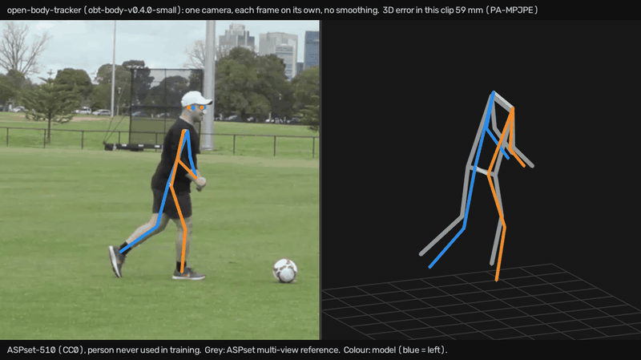

<p align="right"><b>English</b> · <a href="README.ja.md">日本語</a></p>

<h1 align="center">open-body-tracker</h1>

<p align="center">
  Full-body 3D pose from one RGB camera: 23 keypoints in 2D and in metres, in real time.<br>
  <a href="https://yuru-lab.github.io/open-body-tracker/"><b>Browser demo</b></a> ·
  <a href="https://huggingface.co/Yurup/open-body-tracker">Models (Hugging Face)</a> ·
  <a href="docs/MODELS.md">Benchmarks</a>
</p>

<p align="center"></p>

<p align="center"><sub>A person never used in training (<a href="https://github.com/anibali/aspset-510">ASPset-510</a>, CC0).
Grey: reference 3D. Colour: obt-body-v0.3.0, one camera, no smoothing.<br>3D error in this clip 56 mm; 53.7 mm on average.</sub></p>

## Models

| | **obt-body-v0.3.0** | obt-body-v0.3.0-int8 |
|---|---:|---:|
| 3D error, other scenes (Harmony4D, PA-MPJPE) | 71.3 mm | 71.8 mm |
| 2D accuracy (COCO val2017 AP) | 71.6 | 71.7 |
| Speed, one person | 6 ms GPU · 103 ms CPU | 46 ms CPU |

The INT8 model is the same network quantized for CPUs. Versions, more benchmarks and how they were measured:
[docs/MODELS.md](docs/MODELS.md).

Next to other models, same frames and same scoring ([details](docs/MODELS.md#other-models-on-the-same-benchmarks)):

| | 3D error, other scenes | 2D AP | Speed, one person |
|---|---:|---:|---:|
| **obt-body-v0.3.0** | **71.3 mm** | 71.6 | 6 ms GPU · 46 ms CPU (int8) |
| MediaPipe Pose Full / Heavy | 103.3 / 105.8 mm | — | 25 / 52 ms CPU |
| RTMW-m (2D only) | — | 74.1 | 9 ms GPU |
| SAM 3D Body (our teacher, much larger) | 34.6 mm | — | 115 ms GPU |

## How it works

Each frame, YOLOX finds the person (then the last pose's box is reused for about a second), a 256 × 192 crop goes
through the pose model, and a One Euro filter smooths the result.

<p align="center"></p>

## Quick start

```sh
git clone https://github.com/yuru-lab/open-body-tracker && cd open-body-tracker
mise install && mise run setup   # or: Python 3.12 + uv, then `uv sync`
mise run demo                    # webcam; models download on first run
```

```sh
uv run obt-demo --image photo.jpg               # writes photo.pose.jpg
uv run obt-demo --model-version v0.3.0-int8     # faster on a CPU
uv sync --extra gpu && uv run obt-demo --gpu    # CUDA
```

Browser demo on your machine: `mise run web`, then open http://localhost:8000.

## Use it in your code

```python
import cv2
from open_body_tracker.detector import PersonDetector
from open_body_tracker.hub import fetch, model_file
from open_body_tracker.pipeline import PosePipeline

pipeline = PosePipeline(fetch(model_file()), PersonDetector(fetch("yolox_nano.onnx")))
pose = pipeline(cv2.imread("photo.jpg")[:, :, ::-1].copy())  # RGB
pose["xy"]     # (23, 2) image pixels
pose["score"]  # (23,)   confidence
pose["xyz"]    # (23, 3) metres, hip-centred, camera axes (x right, y down, z forward)
```

Keypoints: COCO 17 + big toe, small toe and heel on each foot ([keypoints.py](src/open_body_tracker/keypoints.py)).

## More

- [Model versions and benchmarks](docs/MODELS.md) · [Model card](MODEL_CARD.md) · [Training data](DATA.md)
- [Reproduce the training](docs/REPRODUCE.md): code in [`training/`](training/), labels on
  [Hugging Face](https://huggingface.co/datasets/Yurup/open-body-tracker-labels)

## License

Code and model weights: [Apache-2.0](LICENSE). Thanks to Meta for [SAM 3D Body](https://github.com/facebookresearch/sam-3d-body),
whose predictions were part of the training labels. Details and third-party credits: [docs/LICENSING.md](docs/LICENSING.md) ·
[NOTICE](NOTICE)

Research software, not a medical or measurement device.
