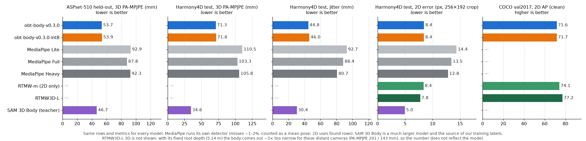

# Models

Every release names its models after the release tag: `obt-body-<tag>[-small][-fp16|-int8]`, and from v0.5.0 the hand
models `obt-hand-<tag>[-small][-fp16|-int8]`.

| Model | Files | Default | What it is |
|---|---|:-:|---|
| **obt-body-v0.5.0-small** | `.onnx` (fp32), `-fp16.onnx`, `.safetensors` | ✓ | v0.4.0-small with rough hand points added for placing the hand crops; body 3D a little better, 2D AP 0.8 lower. The `.safetensors` file also holds the hand model |
| **obt-body-v0.5.0-small-int8** | `-int8.onnx` | | v0.5.0-small quantized to INT8 for CPU |
| **obt-hand-v0.5.0-small** (beta) | `.onnx` (fp32), `-fp16.onnx`, `-int8.onnx` | | 21 points per hand in 2D and 3D, from a 140×140 hand crop. Runs after obt-body-v0.5.0-small (same backbone weights, own head) |
| obt-body-v0.4.0-small | `.onnx` (fp32), `-fp16.onnx`, `.safetensors` | | ViT-S/14, 29 M parameters. About as fast as v0.3.0, 3D error down by a quarter |
| **obt-body-v0.4.0-small-int8** | `-int8.onnx` | | v0.4.0-small quantized to INT8 for CPU |
| **obt-body-v0.4.0** | `.onnx` (fp32), `-fp16.onnx`, `.safetensors` | | ViT-B/14, 96 M parameters. The most accurate; more accurate than InstantHMR medium-commercial on unseen Harmony4D sessions. About 2× slower on CPU |
| **obt-body-v0.4.0-int8** | `-int8.onnx` | | v0.4.0 quantized to INT8 for CPU |
| obt-body-v0.3.0 | `.onnx`, `-fp16.onnx`, `.safetensors` | | Same weights as obt-body-v0.2.0 |
| obt-body-v0.3.0-int8 | `-int8.onnx` | | v0.3.0 quantized to INT8 for CPU |
| obt-body-v0.2.0 | `.onnx`, `-fp16.onnx`, `.safetensors` | | Stage 2 also learns from the multi-view 3D of 7 [ASPset-510](https://github.com/anibali/aspset-510) (CC0) subjects |
| obt-body-v0.1.0 | `.onnx`, `-fp16.onnx`, `.safetensors` | | First release |

All person models take the same input (a 256×192 person crop) and give the same outputs (`xy`, `score`, `xyz` for 23
keypoints); v0.5.0-small adds `hand_xy` and `hand_score` (rough hand points, see [Hands](#hands-beta)).
Files released earlier under other names stay downloadable with the same contents: `obt-body-v2.*` =
v0.2.0, `obt-body-v1.*` = v0.1.0, `obt-h3c.*` = v0.1.0 without the logit outputs (no flip test).

```python
from open_body_tracker.hub import fetch, hand_model_file, model_file
fetch(model_file())                        # models/obt-body-v0.5.0-small.onnx (default)
fetch(hand_model_file())                   # models/obt-hand-v0.5.0-small.onnx
fetch(model_file("v0.4.0"))                # the larger model (no hands)
fetch(model_file("v0.4.0-small-int8"))     # CPU
fetch(model_file("v0.3.0", fp16=True))
```

`uv run obt-demo --model-version v0.4.0` and the **Model** menu of the browser demo switch models;
`uv run obt-demo --hands` adds the hands (Python only for now).
The browser demo uses v0.4.0-small on WebGPU and switches to the INT8 file of the chosen model on the CPU when
WebGPU is not available.

## What changed in v0.5.0

- **Hands (beta).** A second pass finds 21 points per hand (see [Hands](#hands-beta)). The person model got 42 extra
  rows for rough hand points; its attention is masked so the 23 body rows compute what a body-only head would.
- **Body:** obt-body-v0.5.0-small starts from v0.4.0-small and was trained 70 more epochs together with the hands,
  learning the body from v0.4.0-small's outputs (distillation) and the same body data. Its 3D is a little better
  (PA-MPJPE −0.6 mm on Harmony4D 06/16, −0.7 mm on 01/05/15), its COCO 2D AP 0.8 lower and its jitter 0.4 mm
  higher.
  v0.4.0 (ViT-B) stays the most accurate body model; it has no hands.
- **Training data for the hands:** hand crops from Open Images V7 photos (CC BY 2.0), labelled with the hand decoder
  of SAM 3D Body. Details: [MODEL_CARD.md](../MODEL_CARD.md), [DATA.md](../DATA.md).

## What changed in v0.4.0

- **3D in the crop's ray frame.** The 3D target is expressed as seen by the camera turned to look straight through
  the crop centre, so the network does not have to guess where in the image the crop came from (v0.3.0's
  orientation error grew with the distance from the image centre). The pipeline turns it back into camera axes with
  the camera's focal length: `PosePipeline(..., focal=...)` / `obt-demo --focal`; when unknown, a 65° horizontal
  field of view is assumed (`open_body_tracker/geometry.py`). Raw ONNX `xyz` outputs of v0.4.0 are in the ray frame
  (ONNX metadata `obt.frame = ray`).
- **Rigid skeleton.** A shape code sets 10 bone lengths (left and right equal); bone directions come from the 3D
  heads; the joints are rebuilt outwards from the hip midpoint. Bones no longer stretch from frame to frame.
- **Finer patch grid** (26×20 instead of 18×14) and the **small model** (ViT-S/14).
- **Training data:** adds multi-view 3D of 11 Harmony4D training sessions (MIT; 02–04, 07–14; none of the evaluation
  sessions) to the SAM 3D Body teacher labels, COCO and ASPset of earlier releases. The small model also learns from
  the outputs of a larger obt model (distillation). Details: [MODEL_CARD.md](../MODEL_CARD.md).
- **Flip test** averages the decoded outputs of the crop and its mirror (the 3D goes through the rigid skeleton).

## Benchmarks

Each model was scored with the same code and the same frames for every model. None of the benchmark images or
recording sessions were used for training. The v0.4.0 recipe was chosen on ASPset held-out and Harmony4D 01/05/15,
so for v0.4.0 those two are development results; Harmony4D 06/16 stayed closed until both v0.4.0 models were fixed
and was scored once. v0.5.0-small was chosen on hand results and watched on ASPset and Harmony4D 01/05/15 so that
the body would not get worse; Harmony4D 06/16 was then scored once for it. Intervals are 95% bootstrap intervals over
recordings (ASPset) or recording × camera (Harmony4D).

| | v0.3.0 | v0.4.0-small | **v0.5.0-small** | **v0.4.0** |
|---|---:|---:|---:|---:|
| COCO val2017 keypoint AP, clean (4,737 images) | 71.6 | 69.9 | 69.1 | **72.8** |
| COCO val2017 keypoint AP, full | 72.6 | 70.7 | 69.9 | **73.9** |
| ASPset-510 held-out, PA-MPJPE | 53.7 mm | 50.3 mm | 50.1 mm | **48.1 mm** |
| ASPset-510 held-out, MPJPE | 75.4 mm | 71.7 mm | 71.0 mm | **68.0 mm** |
| Harmony4D test (01, 05, 15), PA-MPJPE | 71.3 mm | 52.8 mm | 52.1 mm | **48.9 mm** |
| Harmony4D test (01, 05, 15), MPJPE | 127.0 mm | 73.7 mm | 72.3 mm | **66.9 mm** |
| Harmony4D test (01, 05, 15), jitter (acceleration error) ¹ | 44.8 mm | 40.3 mm | 40.7 mm | **38.3 mm** |
| Harmony4D test (01, 05, 15), 2D error in the 256×192 crop | 8.45 px | 6.16 px | 6.19 px | **5.96 px** |
| Harmony4D test (06, 16), PA-MPJPE ² | — | 49.4 mm [48.7, 50.2] | 48.8 mm [48.0, 49.5] | **45.2 mm** [44.5, 45.9] |
| Harmony4D test (06, 16), MPJPE ² | — | 62.5 mm | 61.4 mm | **57.7 mm** |
| Harmony4D test (06, 16), jitter ² | — | 41.5 mm | 41.9 mm | **38.5 mm** |
| CPU, ONNX Runtime, 4 threads (Core i5-12600), batch 1: fp32 / int8 ³ | 111 / 47 ms | 82 / 48 ms | 82 / 52 ms | 248 / 120 ms |
| GPU, PyTorch, batch 1 (RTX 5080): fp16 / fp32 ⁴ | 3.7 / 7.8 ms | 5.2 / 7.8 ms | 4.7 / 6.9 ms | 5.5 / 12.7 ms |

¹ Measured on the frame triples where MediaPipe also found the person (the comparison set below); v0.3.0 was
listed with 46.9 mm on all triples before.
² Two more Harmony4D test sequences (06_sword3, 16_mma5; 48,280 crops, jitter on all 48,184 triples), kept
closed until the v0.4.0 candidates were fixed and scored once, and scored once more for v0.5.0-small. Not run with
v0.3.0.
³ Measured together, on a machine that was also running other work; v0.3.0 was listed with 103 / 46 ms before.
v0.5.0-small was measured later on the same machine (v0.4.0-small alongside: 78 / 46 ms). Without the hands.
⁴ Including the decoding (rigid skeleton) on the GPU. At batch 1 the time is dominated by the number of GPU kernel
launches rather than by arithmetic, so the smaller network gains little here; on the RTX 3060 Ti v0.3.0 took
5.6 / 8.8 ms. These batch-1 PyTorch times vary by 1–2 ms (once by 5 ms) from run to run; v0.5.0-small is the median
of 4 runs (v0.4.0-small in the same runs: 4.7 / 7.3 ms). Without the hands.

With the flip test, v0.4.0 improves to PA-MPJPE 47.7 mm (ASPset), 48.6 mm (Harmony4D 01/05/15) and 44.6 mm
(06/16), and jitter to 35.9 / 36.3 mm; v0.4.0-small to 48.9 mm PA-MPJPE and 38.9 mm jitter on 06/16.

### The benchmarks

- **COCO val2017**, ground-truth person boxes. "Clean" removes the photos that also appear in the training archives.
  `training/evaluate_coco.py` reproduces these numbers.
- **ASPset-510 held-out subjects**: the 3 people of the official test split (4d9e, c9f8, fb7c), 90 recordings,
  every 5th frame (3,877 frames). v0.2.0 / v0.3.0 never saw them, but were trained on 7 other people filmed in the
  same studio, so the gain here is larger than you should expect elsewhere.
- **Harmony4D test** ([dataset](https://huggingface.co/datasets/Jyun-Ting/Harmony4D), MIT on the dataset card):
  sequences of two people in close contact, indoors and outdoors, 20–22 fisheye GoPros: 01_hugging, 05_sword2 and
  15_mma4 (used since v0.1.0), and 06_sword3 and 16_mma5 (opened once for v0.4.0). Raw (distorted) frames cropped
  around the ground-truth boxes, as at run time. Accuracy: every 5th frame of every camera (26,474 crops for
  01/05/15). Jitter: every frame of 4 cameras. v0.4.0 is trained on 11 other Harmony4D sessions (training split,
  02–04 and 07–14), so the camera rig and capture style are familiar to it, but none of these recordings are.

3D is scored on 12 body points (shoulders to ankles), hip-centred. PA-MPJPE aligns rotation and scale first;
MPJPE keeps the camera axes.

### v0.2.0 against v0.1.0

Harmony4D paired differences, v0.2.0 − v0.1.0: PA-MPJPE −4.7 mm [−5.1, −4.3], MPJPE −3.3 mm [−3.8, −2.8], jitter
+0.3 mm [−0.2, +0.7]. v0.2.0 is better in all three sequences (hugging 67.5 → 66.5, sword 70.8 → 65.3, MMA
95.5 → 91.4 mm). v0.2.0 became the default by a rule fixed before Harmony4D was scored (PA-MPJPE interval below 0,
MPJPE below +5 mm, jitter below +1 mm); all three held.

### INT8 against float32

`scripts/quantize_onnx.py` makes the INT8 file with ONNX Runtime dynamic quantization: int8 weights per output
channel, uint8 activations. The output head and the second MLP layer of blocks 8 and 11 stay float32, because
quantizing them moves the 3D output by over 60 mm (large activations in those layers). Paired differences,
int8 − float32: ASPset PA-MPJPE +0.18 mm [0.07, 0.29], Harmony4D PA-MPJPE +0.52 mm [0.45, 0.59], jitter
+1.28 mm [1.05, 1.52]. All five release checks fixed beforehand passed (3D and jitter within +2 mm, COCO AP drop
below 1 point, at most 60% of the float32 time).

v0.4.0 and v0.4.0-small are quantized the same way (the shape head also stays float32). Paired difference on ASPset,
int8 − float32: PA-MPJPE +0.2 mm for both ([0.1, 0.3] for v0.4.0-small, [0.2, 0.3] for v0.4.0).

INT8 helps on CPU only. On a GPU use the fp16 or fp32 file.

## Hands (beta)

From v0.5.0 the pipeline can also track both hands: 21 points per hand (four per finger, from the tip down to the
knuckle, or to the base joint for the thumb, and the wrist; names in `open_body_tracker/hands.py`), in image pixels
and in metres.

1. The person model gives rough hand points (`hand_xy`) from the 256×192 person crop.
2. Each hand gets a square crop of 2.0 × the extent of those points, resized to 140×140 (10×10 patches). A left hand
   is mirrored first: the hand model sees right hands only.
3. obt-hand-v0.5.0-small runs the person model's backbone (same weights, stored again in its file) with its own neck
   and 21-point head: 2D in hand-crop pixels and 3D relative to the wrist, in the hand crop's ray frame.
4. The pipeline turns the 3D into camera axes as it does the body, places it at the body's wrist and smooths it with
   a One Euro filter.

```python
pipeline = PosePipeline(fetch(model_file()), detector, hand_model=fetch(hand_model_file()))
pose = pipeline(rgb)
pose["hands"]["right"]  # None, or dict(xy (21, 2) image px, score (21,), xyz (21, 3) metres, box)
```

A hand is skipped when the body's wrist score is low (wrist out of view or hidden). The hand points' scores drop for
blurred or tiny hands but do not tell hidden fingers from visible ones: every finger is always predicted.

**Accuracy.** We have not found a public hand benchmark with a licence that lets us publish results, so no hand
accuracy numbers are given here, and the hand model is a beta. What we can say: each hand pass uses only the
140×140 crop, so far-away hands (a few dozen pixels in the image) are rough, and when the person model misplaces a
hand, the crop misses it.

**Speed** (both hands, batch 2): CPU (Core i5-12600, ONNX Runtime, 4 threads) 28 ms fp32, 17 ms int8; GPU PyTorch
(RTX 5080) 3.2 ms fp16. With TensorRT fp16 on an RTX 3060 Ti, batch 1, one hand crop takes 0.9 ms and the person
crop 1.7 ms (each file run separately). The INT8 hand file moves the outputs of the float32 file by 1.2 px and
4.8 mm on average (1,000 Open Images hand crops); the fp16 file by 0.03 px and 0.07 mm.

## Other models on the same benchmarks

For reference, other public models were run once on the same frames and scored with the same code.



| | ASPset PA-MPJPE | Harmony4D PA-MPJPE | Harmony4D jitter | 2D error (crop px) | COCO AP clean |
|---|---:|---:|---:|---:|---:|
| **obt-body-v0.4.0** | **48.1 mm** | 48.9 mm | 38.3 mm | 5.96 | 72.8 |
| **obt-body-v0.4.0-small** | 50.3 mm | 52.8 mm | 40.3 mm | 6.16 | 69.9 |
| **obt-body-v0.5.0-small** | 50.1 mm | 52.1 mm | 40.7 mm | 6.19 | 69.1 |
| obt-body-v0.3.0 | 53.7 mm | 71.3 mm | 44.8 mm | 8.45 | 71.6 |
| obt-body-v0.3.0-int8 | 53.9 mm | 71.8 mm | 46.0 mm | 8.44 | 71.7 |
| InstantHMR medium-commercial ⁴ | 64.9 mm | 40.6 mm | 35.6 mm | 5.91 | — |
| MediaPipe Pose Landmarker Lite | 92.9 mm | 110.5 mm | 92.7 mm | 14.4 ¹ | — |
| MediaPipe Pose Landmarker Full | 87.8 mm | 103.3 mm | 88.4 mm | 13.5 ¹ | — |
| MediaPipe Pose Landmarker Heavy | 92.3 mm | 105.8 mm | 80.7 mm | 12.8 ¹ | — |
| RTMW-m (2D only) | — | — | — | 8.36 | 74.1 |
| RTMW3D-L | ² | ² | ² | 7.76 | 77.2 |
| SAM 3D Body (our teacher) ³ | 46.7 mm | 34.6 mm | 30.4 mm | 4.97 | — |

Jitter here is measured on the 24,919 frame triples where every model returned a pose, so obt's value differs
slightly from the table above.

| Speed, one person | Device | Time |
|---|---|---:|
| obt-body-v0.3.0 | GPU fp32 / fp16, batch 1 | 8.8 / 5.5 ms |
| obt-body-v0.3.0 / -int8 | CPU, 4 threads | 103 / 46 ms |
| RTMW-m | GPU fp32 / fp16, batch 1 | 8.6 / 6.0 ms |
| RTMW3D-L | GPU fp32 / fp16, batch 1 | 13.7 / 8.1 ms |
| MediaPipe Lite / Full / Heavy (own detector included) | CPU | 19 / 25 / 52 ms |
| SAM 3D Body | GPU | 115 ms |

GPU: RTX 3060 Ti, PyTorch, forward pass only. CPU: Core i5-12600.

How each model was run:

- Every model gets the same ground-truth person box. obt-body and RTMW crop it at their own input size
  (RTMW-m 256×192, RTMW3D-L 384×288).
- **MediaPipe** 0.10.35, `pose_landmarker_{lite,full,heavy}.task`, image mode, confidence thresholds 0.5, on the
  person crop; 3D from its world landmarks. It runs its own detector and misses 1–2% of crops; misses count as an
  average pose. ¹ 2D error on the crops it found.
- **RTMW** from [MMPose](https://github.com/open-mmlab/mmpose) (Apache-2.0): RTMW-m (cocktail14, 2D whole body)
  and RTMW3D-L (cocktail14, 3D). ² RTMW3D gives image position plus depth relative to the root, and needs the
  root's distance to the camera. With its default fixed distance (5.14 m) the bodies in these far-away camera views
  come out about 3× too narrow for their depth, and its PA-MPJPE (201 / 143 mm) reflects that assumption rather than
  the model, so we do not list it.
- ³ **SAM 3D Body** ([Meta](https://github.com/facebookresearch/sam-3d-body)) sees the whole image and is a much
  larger model. Its predictions are the training labels of obt-body, so it is an upper reference, not a competitor.

- ⁴ **InstantHMR medium-commercial** (fit 0, its better setting here; SAM License), ONNX, on the same crops. It
  was trained on other recordings of the same three Harmony4D sessions (same people, venue and cameras), so
  Harmony4D 01/05/15 is familiar ground for it. On the two sessions it has not seen (06, 16) it scores PA-MPJPE
  47.1 mm [46.2, 48.0], MPJPE 67.0 mm and jitter 43.7 mm, against 45.2 mm, 57.7 mm and 38.5 mm for v0.4.0
  (paired PA-MPJPE difference −1.9 mm [−2.4, −1.4]), 49.4 mm, 62.5 mm and 41.5 mm for v0.4.0-small
  (+2.4 mm [1.8, 2.9]) and 48.8 mm, 61.4 mm and 41.9 mm for v0.5.0-small (+1.7 mm [1.2, 2.2]). Its own published
  speed is about 1 ms (RTX 4070, TensorRT); we did not time it.

None of these are claims about the other models in general: one run, on these benchmarks and this crop setup.

## Flip test

The flip test runs the crop and its mirror image together and averages the two predictions, the mirror's left and
right points swapped. Up to v0.3.0 it averages the classifier outputs (x bins reversed) and then decodes; v0.4.0 and
later average the decoded outputs (x mirrored), because the 3D goes through the rigid skeleton. The hand pass is not
flip-tested. It lowers the 3D error by
about 0.5–1 mm and the jitter by 2–3.5 mm (v0.3.0: −3.5 mm [−4.1, −3.0]; v0.4.0: −2.4 mm [−3.1, −1.9] on
Harmony4D 01/05/15). It is off by default because it doubles the pose-model time.

- Python: `PosePipeline(..., flip=True)`, `obt-demo --flip`, or `open_body_tracker.flip.run(session, crops)`.
- Browser demo: **Flip test → on**.

## Notes

- One training seed per model. The differences above are between these weights, not averages over runs.
- ASPset reference 3D comes from a markerless multi-view reconstruction. Harmony4D's 3D comes from multi-view
  triangulation plus a fitted body model. Neither is marker-based motion capture.
- The ASPset, Harmony4D and other-model numbers were measured with the research evaluation code, which is not in
  this repository.
- Not a certified measurement device. Evaluate it for your own use case.
