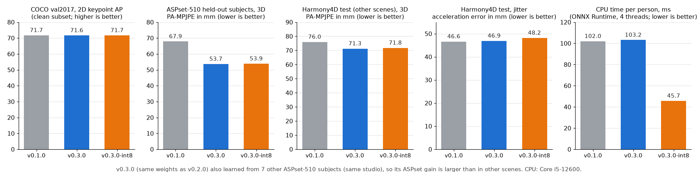

# Models

Every release names its models after the release tag: `obt-body-<tag>[-fp16|-int8]`.

| Model | Files | Default | What it is |
|---|---|:-:|---|
| **obt-body-v0.3.0** | `.onnx` (fp32), `-fp16.onnx`, `.safetensors` | ✓ | Same weights as obt-body-v0.2.0 |
| **obt-body-v0.3.0-int8** | `-int8.onnx` | | v0.3.0 quantized to INT8 for CPU: 2.3× faster, about the same accuracy |
| obt-body-v0.2.0 | `.onnx`, `-fp16.onnx`, `.safetensors` | | Stage 2 also learns from the multi-view 3D of 7 [ASPset-510](https://github.com/anibali/aspset-510) (CC0) subjects |
| obt-body-v0.1.0 | `.onnx`, `-fp16.onnx`, `.safetensors` | | First release |

All models share the architecture, input and outputs. Files released earlier under other names stay downloadable
with the same contents: `obt-body-v2.*` = v0.2.0, `obt-body-v1.*` = v0.1.0, `obt-h3c.*` = v0.1.0 without the logit
outputs (no flip test).

```python
from open_body_tracker.hub import fetch, model_file
fetch(model_file())                  # models/obt-body-v0.3.0.onnx (default)
fetch(model_file("v0.3.0-int8"))     # CPU
fetch(model_file("v0.1.0", fp16=True))
```

`uv run obt-demo --model-version v0.3.0-int8` and the **Model** menu of the browser demo switch models.
The browser demo uses v0.3.0 on WebGPU and switches to v0.3.0-int8 on the CPU when WebGPU is not available.
In a browser INT8 gains less than natively (WASM has no VNNI): about 200 ms per person with several threads
(Core i5-12600, Chrome), against 285 ms for float32; WebGPU is much faster where available.



## Benchmarks

Each model was scored once per benchmark, with the same code and the same frames for every model. None of the
benchmark images or subjects were used for training or for choosing a checkpoint. Intervals are 95% bootstrap
intervals over recordings (ASPset) or recording × camera (Harmony4D).

| | v0.1.0 | v0.3.0 | v0.3.0-int8 |
|---|---:|---:|---:|
| COCO val2017 keypoint AP, clean (4,737 images) | 71.7 | 71.6 | 71.7 |
| COCO val2017 keypoint AP, full | 72.7 | 72.6 | 72.9 |
| ASPset-510 held-out, PA-MPJPE | 67.9 mm | **53.7 mm** | 53.9 mm |
| ASPset-510 held-out, MPJPE | 92.7 mm | **75.4 mm** | 75.4 mm |
| Harmony4D test, PA-MPJPE | 76.0 mm | **71.3 mm** | 71.8 mm |
| Harmony4D test, MPJPE | 130.3 mm | **127.0 mm** | 127.5 mm |
| Harmony4D test, jitter (acceleration error) | 46.6 mm | 46.9 mm | 48.2 mm |
| Harmony4D test, 2D error in the 256×192 crop | 8.38 px | 8.45 px | 8.44 px |
| CPU, ONNX Runtime 1.32, 4 threads (Core i5-12600), batch 1 | 102 ms | 103 ms | **46 ms** |
| GPU, PyTorch fp16 (RTX 3060 Ti), batch 1 | 5.6 ms | 5.6 ms | — |

The flip test (below) lowers v0.3.0's Harmony4D PA-MPJPE to 70.0 mm and jitter to 43.4 mm, and raises COCO clean
AP to 72.1, at twice the time.

### The benchmarks

- **COCO val2017**, ground-truth person boxes. "Clean" removes the photos that also appear in the training archives.
  `training/evaluate_coco.py` reproduces these numbers.
- **ASPset-510 held-out subjects**: the 3 people of the official test split (4d9e, c9f8, fb7c), 90 recordings,
  every 5th frame (3,877 frames). v0.2.0 / v0.3.0 never saw them, but were trained on 7 other people filmed in the
  same studio, so the gain here is larger than you should expect elsewhere.
- **Harmony4D test** ([dataset](https://huggingface.co/datasets/Jyun-Ting/Harmony4D), MIT on the dataset card):
  3 sequences (hugging, sword fighting, MMA) of two people in close contact, indoors and outdoors, 20–22 fisheye
  GoPros. Never used for training. Raw (distorted) frames cropped around the ground-truth boxes, as at run time.
  Accuracy: every 5th frame of every camera (26,474 crops). Jitter: every frame of 4 cameras (26,176 triples).

3D is scored on 12 body points (shoulders to ankles), hip-centred. PA-MPJPE aligns rotation and scale first;
MPJPE keeps the camera axes.

### v0.2.0 against v0.1.0

Harmony4D paired differences, v0.2.0 − v0.1.0: PA-MPJPE −4.7 mm [−5.1, −4.3], MPJPE −3.3 mm [−3.8, −2.8], jitter
+0.3 mm [−0.2, +0.7]. v0.2.0 is better in all three sequences (hugging 67.5 → 66.5, sword 70.8 → 65.3, MMA
95.5 → 91.4 mm). v0.2.0 became the default by a rule fixed before Harmony4D was scored (PA-MPJPE interval below 0,
MPJPE below +5 mm, jitter below +1 mm); all three held.

### INT8 against float32

`scripts/quantize_onnx.py` makes the INT8 file with ONNX Runtime dynamic quantization: int8 weights per output
channel, uint8 activations. The output head and the second MLP layer of blocks 8 and 11 stay float32, because
quantizing them moves the 3D output by over 60 mm (large activations in those layers). Paired differences,
int8 − float32: ASPset PA-MPJPE +0.18 mm [0.07, 0.29], Harmony4D PA-MPJPE +0.52 mm [0.45, 0.59], jitter
+1.28 mm [1.05, 1.52]. All five release checks fixed beforehand passed (3D and jitter within +2 mm, COCO AP drop
below 1 point, at most 60% of the float32 time).

INT8 helps on CPU only. On a GPU use the fp16 or fp32 file.

## Other models on the same benchmarks

For reference, other public models were run once on the same frames and scored with the same code.


| | ASPset PA-MPJPE | Harmony4D PA-MPJPE | Harmony4D jitter | 2D error (crop px) | COCO AP clean |
|---|---:|---:|---:|---:|---:|
| **obt-body-v0.3.0** | **53.7 mm** | **71.3 mm** | **44.8 mm** | 8.45 | 71.6 |
| obt-body-v0.3.0-int8 | 53.9 mm | 71.8 mm | 46.0 mm | 8.44 | 71.7 |
| MediaPipe Pose Landmarker Lite | 92.9 mm | 110.5 mm | 92.7 mm | 14.4 ¹ | — |
| MediaPipe Pose Landmarker Full | 87.8 mm | 103.3 mm | 88.4 mm | 13.5 ¹ | — |
| MediaPipe Pose Landmarker Heavy | 92.3 mm | 105.8 mm | 80.7 mm | 12.8 ¹ | — |
| RTMW-m (2D only) | — | — | — | 8.36 | 74.1 |
| RTMW3D-L | ² | ² | ² | 7.76 | 77.2 |
| SAM 3D Body (our teacher) ³ | 46.7 mm | 34.6 mm | 30.4 mm | 4.97 | — |

Jitter here is measured on the 24,919 frame triples where every model returned a pose, so obt's value differs
slightly from the table above.

| Speed, one person | Device | Time |
|---|---|---:|
| obt-body-v0.3.0 | GPU fp32 / fp16, batch 1 | 8.8 / 5.5 ms |
| obt-body-v0.3.0 / -int8 | CPU, 4 threads | 103 / 46 ms |
| RTMW-m | GPU fp32 / fp16, batch 1 | 8.6 / 6.0 ms |
| RTMW3D-L | GPU fp32 / fp16, batch 1 | 13.7 / 8.1 ms |
| MediaPipe Lite / Full / Heavy (own detector included) | CPU | 19 / 25 / 52 ms |
| SAM 3D Body | GPU | 115 ms |

GPU: RTX 3060 Ti, PyTorch, forward pass only. CPU: Core i5-12600.

How each model was run:

- Every model gets the same ground-truth person box. obt-body and RTMW crop it at their own input size
  (RTMW-m 256×192, RTMW3D-L 384×288).
- **MediaPipe** 0.10.35, `pose_landmarker_{lite,full,heavy}.task`, image mode, confidence thresholds 0.5, on the
  person crop; 3D from its world landmarks. It runs its own detector and misses 1–2% of crops; misses count as an
  average pose. ¹ 2D error on the crops it found.
- **RTMW** from [MMPose](https://github.com/open-mmlab/mmpose) (Apache-2.0): RTMW-m (cocktail14, 2D whole body)
  and RTMW3D-L (cocktail14, 3D). ² RTMW3D gives image position plus depth relative to the root, and needs the
  root's distance to the camera. With its default fixed distance (5.14 m) the bodies in these far-away camera views
  come out about 3× too narrow for their depth, and its PA-MPJPE (201 / 143 mm) reflects that assumption rather than
  the model, so we do not list it.
- ³ **SAM 3D Body** ([Meta](https://github.com/facebookresearch/sam-3d-body)) sees the whole image and is a much
  larger model. Its predictions are the training labels of obt-body, so it is an upper reference, not a competitor.

None of these are claims about the other models in general: one run, on these benchmarks and this crop setup.

## Flip test

The flip test runs the crop and its mirror image together, averages the classifier outputs (mirror's left and
right points swapped, x bins reversed) and then decodes. It lowers the 3D error by about 1 mm and the jitter by
3.5 mm (v0.3.0: −3.5 mm [−4.1, −3.0]). It is off by default because it doubles the pose-model time.

- Python: `PosePipeline(..., flip=True)`, `obt-demo --flip`, or `open_body_tracker.flip.run(session, crops)`.
- Browser demo: **Flip test → on**.

## Notes

- One training seed per model. The differences above are between these weights, not averages over runs.
- ASPset reference 3D comes from a markerless multi-view reconstruction. Harmony4D's 3D comes from multi-view
  triangulation plus a fitted body model. Neither is marker-based motion capture.
- The ASPset, Harmony4D and other-model numbers were measured with the research evaluation code, which is not in
  this repository.
- Not a certified measurement device. Evaluate it for your own use case.
