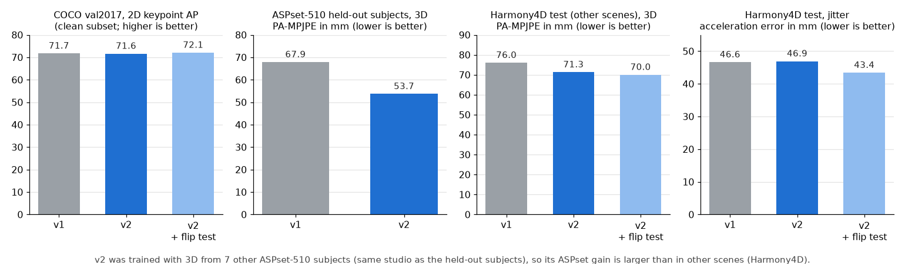

# Model versions

| Version | Files | Released | Default | What changed |
|---|---|---|:-:|---|
| **obt-body-v2** | `obt-body-v2.onnx`, `obt-body-v2-fp16.onnx`, `obt-body-v2.safetensors` | v0.2.0 | ✓ | Stage 2 also learns from the multi-view 3D of 7 [ASPset-510](https://github.com/anibali/aspset-510) (CC0) subjects |
| obt-body-v1 | `obt-body-v1.onnx`, `obt-body-v1-fp16.onnx`, `obt-body-v1.safetensors` | v0.1.0 | | First release. Same weights as `obt-h3c.*` |

The two models have the same architecture, input, outputs and speed; only the weights differ. `obt-h3c.onnx` is
v1's original file name and is kept for old code. It lacks the logit outputs, so it cannot run the flip test.

```python
from open_body_tracker.hub import fetch, model_file
fetch(model_file("v2"))         # models/obt-body-v2.onnx (default)
fetch(model_file("v1", fp16=True))
```

`uv run obt-demo --model-version v1` and the **Model** menu of the browser demo switch between them.



## Benchmarks

Each model was scored once per benchmark, with the same code and the same frames for both. None of the
benchmark images or subjects were used for training or for choosing a checkpoint. Intervals are 95% bootstrap
intervals over recordings (ASPset) or recording × camera (Harmony4D).

### 2D: COCO val2017 (ground-truth boxes)

| | v1 | v2 | v2 + flip test |
|---|---:|---:|---:|
| keypoint AP, clean (4,737 images; photos also in the training archives removed) | 71.7 | 71.6 | 72.1 |
| keypoint AP, full val2017 | 72.7 | 72.6 | 73.3 |

### 3D: ASPset-510 held-out subjects (same studio as v2's extra training data)

3 subjects of the official test split (4d9e, c9f8, fb7c), 90 recordings, every 5th frame (3,877 frames).
Body 12 points (shoulders to ankles), hip-centred.

| | v1 | v2 |
|---|---:|---:|
| PA-MPJPE | 67.9 mm [65.5, 70.4] | **53.7 mm** [51.6, 55.8] |
| MPJPE (hip-aligned, camera axes) | 92.7 mm [89.3, 96.2] | **75.4 mm** [72.7, 78.0] |
| left/right depth order correct | 97.8 % | 99.1 % |

v2 never saw these 3 people, but it was trained on 7 other people filmed in the same studio with the same cameras.
The gain here is therefore larger than you should expect from your own camera and room. Use the next benchmark
for that.

### 3D: Harmony4D test (other scenes, never used for training)

[Harmony4D](https://huggingface.co/datasets/Jyun-Ting/Harmony4D) (MIT on the dataset card) test split, 3 sequences
(hugging, sword fighting, MMA): two people in close contact, filmed indoors and outdoors by 20–22 fisheye GoPros.
The raw (distorted) frames are cropped around the ground-truth person boxes, as at run time. Accuracy uses every 5th
frame of every camera (26,474 person crops). Jitter uses every frame of 4 cameras (acceleration error, 26,176 frame
triples).

| | v1 | v2 | v2 + flip test |
|---|---:|---:|---:|
| PA-MPJPE | 76.0 mm | **71.3 mm** | 70.0 mm |
| MPJPE (hip-aligned, camera axes) | 130.3 mm | 127.0 mm | 126.1 mm |
| jitter: acceleration error | 46.6 mm | 46.9 mm | 43.4 mm |
| 2D error in the 256×192 crop | 8.38 px | 8.45 px | 8.39 px |

Paired differences, v2 − v1: PA-MPJPE −4.7 mm [−5.1, −4.3], MPJPE −3.3 mm [−3.8, −2.8], jitter +0.3 mm
[−0.2, +0.7]. v2 is better in all three sequences (hugging 67.5 → 66.5, sword 70.8 → 65.3, MMA 95.5 → 91.4 mm).
Cameras of the same sequence see the same motion, so these intervals are on the narrow side, and there are only
3 sequences.

Rule for the default model, fixed before Harmony4D was scored: v2 becomes the default if, against v1, the upper end
of the PA-MPJPE difference interval is below 0, the MPJPE difference is below +5 mm, and the jitter difference is
below +1 mm. All three held.

### Speed (pose model only, one 256×192 crop)

| | v1 | v2 |
|---|---:|---:|
| CPU, ONNX Runtime 1.32, 4 threads (Core i5-12600), batch 1 | 102 ms | 103 ms |
| GPU, PyTorch fp16 (RTX 3060 Ti), batch 1 | 5.6 ms | 5.6 ms |
| GPU, PyTorch fp16 (RTX 3060 Ti), batch 32, per crop | 2.1 ms | 2.1 ms |

The flip test runs every crop twice, so it roughly doubles these times.

## Flip test

The flip test runs the crop and its mirror image together, averages the classifier outputs (mirror's left and
right points swapped, x bins reversed) and then decodes. On the benchmarks above it lowers the 3D error by about
1 mm and the jitter by 3.5 mm (v2: −3.5 mm [−4.1, −3.0]). It is off by default because it doubles the pose-model
time.

- Python: `PosePipeline(..., flip=True)`, `obt-demo --flip`, or `open_body_tracker.flip.run(session, crops)`.
- Browser demo: **Flip test → on**.

## Notes

- One training seed per model. The differences above are between these two weights, not averages over runs.
- ASPset reference 3D comes from a markerless multi-view reconstruction. Harmony4D's 3D comes from multi-view
  triangulation plus a fitted body model. Neither is marker-based motion capture.
- The ASPset and Harmony4D numbers were measured with the research evaluation code, which is not in this repository.
  `training/evaluate_coco.py` reproduces the COCO numbers.
- Not a certified measurement device. Evaluate it for your own use case.
